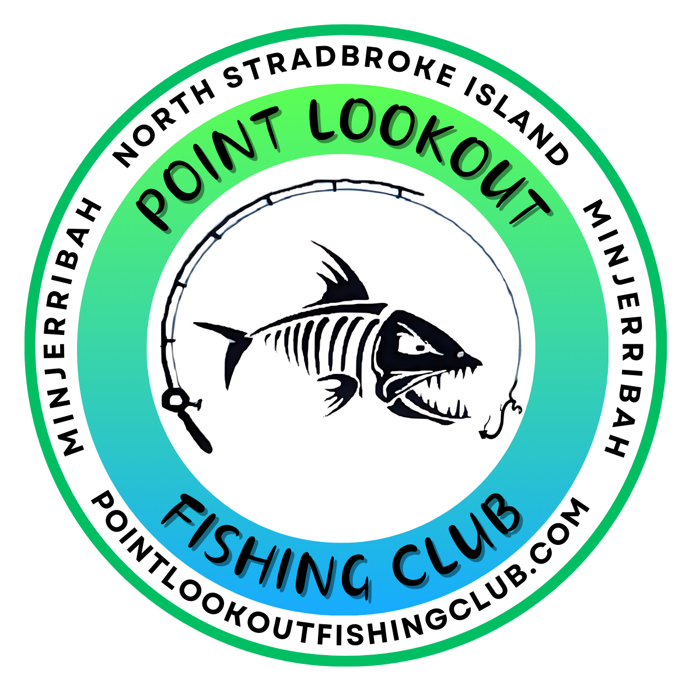

# Point Lookout Fishing Club | Digital Clubhouse



A purpose-built digital clubhouse for Point Lookout Fishing Club on Minjerribah (North Stradbroke Island), Queensland. It brings public fishing education, member participation, club administration, community events, fundraising, sponsorship and communications together in one platform.

**Status: working committee-review platform.** The source includes substantial operational workflows, not just a static website. General club adoption, live records, external service activation and policy decisions remain subject to committee approval. A deployed interface is not evidence that the club has adopted every feature or enabled every integration.

**Documentation reviewed: 25 November 2026.**

## Visit the clubhouse

[Open the live clubhouse](https://plfc-clubhouse.auraofintelligence.workers.dev/)

| Area | Purpose |
| --- | --- |
| [Home](https://plfc-clubhouse.auraofintelligence.workers.dev/#home) | Club introduction, Finnius, local community and wildlife rescue |
| [What's on](https://plfc-clubhouse.auraofintelligence.workers.dev/#events) | Club dates, local meets, invitationals and calendar options |
| [Go fishing](https://plfc-clubhouse.auraofintelligence.workers.dev/#fishing) | Location, date, method and target-specific fishing briefings |
| [Fishing guide](https://plfc-clubhouse.auraofintelligence.workers.dev/#guide) | Illustrated fishing skills, identification, rules and catch care |
| [Sponsors](https://plfc-clubhouse.auraofintelligence.workers.dev/#sponsors) | Sponsorship opportunities and offers |
| [Grants](https://plfc-clubhouse.auraofintelligence.workers.dev/#grants) | Funding research and club project opportunities |
| [Shop](https://plfc-clubhouse.auraofintelligence.workers.dev/#shop) | Merchandise, tickets, donations and other published offers |
| [Members](https://plfc-clubhouse.auraofintelligence.workers.dev/#members) | Private member services, participation and records |
| [Stock and prices](https://plfc-clubhouse.auraofintelligence.workers.dev/#stock) | Authorised financial, stock and order workflows |
| [Committee](https://plfc-clubhouse.auraofintelligence.workers.dev/#committee) | Role-based club operations |
| [Social Studio review](https://plfc-clubhouse.auraofintelligence.workers.dev/social-campaign-review.html) | No-login annual campaign planning rehearsal, using browser-local trial data |
| [Read-only showcase](https://plfc-clubhouse.auraofintelligence.workers.dev/showcase.html) | Invitation-only demonstration with separate fictional records |
| [Constitution](https://plfc-clubhouse.auraofintelligence.workers.dev/constitution.pdf) | Public V1.2 copy; adoption date remains unverified |

Protected sections require appropriate authorisation. Public visitors do not need to sign in to browse the public site.

## Public clubhouse and fishing education

- Responsive club home, original club identity, Finnius animations, guided first-visit tour, persistent Guide me controls and contextual help.
- Local fishing meets and proposed invitationals, with catch-and-release competition principles and guided Google Calendar and other calendar import options. Calendar events distinguish confirmed dates from proposals. The unheld November hotel catch-up has been removed rather than presented as club history.
- Daily fishing briefing with Open-Meteo weather and marine forecasts, wind, swell, reference tides, astronomical calculations, daylight, moon events, estimated lunar periods, official BOM radar link and contextual guidance.
- Extensive illustrated fishing reference library covering fish and baitfish identification, shore and bay bait, pipis, crabbing, bugs, bait gathering and nets, knots and strength comparisons, species-specific rigs, running-sinker, reef, pelagic and heavy-fish methods, tackle preparation and fish cleaning.
- Water rules, marine park zones, customary fishing rights, spearfishing and diving, jetty etiquette, sharks and rays, responsible catch handling, brag-mat photographs, seafood preparation and first aid.
- Direct Wildlife Rescue Minjerribah links and relevant rescue contacts; the companion rescue application remains a separate project.
- Finnius is the club's existing character. Original silent chat and wave animations can be paused; reduced-motion users can initiate playback manually. Live GPT, voice and avatar integration are not enabled.

Fishing information supports preparation and learning, not a legal or safety determination. Brisbane Bar tides are official 2026 and 2027 high/low reference predictions, approximately 39 km from Point Lookout, without a local correction. The displayed curve interpolates between those extrema. Lunar periods are estimates. Forecast failures are shown as unavailable, not fabricated conditions. Check current official advice, marine park rules and local conditions before fishing.

## Member clubhouse

| Workspace | Capabilities |
| --- | --- |
| Membership | Applications, payment verification, one-time account invitations, membership numbers, pack fulfilment, renewals, status and birthday preferences |
| Returning members | Reviewed returning-member offers and complimentary-year waivers, separate Secretary and Treasurer approval, fee snapshots, acceptance and reporting |
| Personal calendar | Public and explicitly released member events, calendar exports and publication notices |
| News and minutes | Approved member editions of meeting minutes, newsletter archive, group editions, recipes and birthday greetings for opted-in members |
| Catch journal | Private catches, photos, species details and precise map pins; sharing is a separate choice |
| Member network | Cartoon angler profiles, optional discovery, friend requests, controlled photo and catch-map sharing, conversations and replies |
| Club honours | Verified catches, species leaderboards, monthly awards, competition targets, placings and linked sponsor offers |
| Junior competitions | Guardian-managed child entries, private evidence, verified results and separate nickname and photograph publication permissions |
| Member recipe book | Member-submitted recipes with chosen bylines and up to four ordered photos; edit, withdraw and export |
| Shared meals | Host invitations, open eligible-member meals, guest places, contributions, dietary notes and attendance; private addresses are restricted to the host and confirmed guests |
| Equipment wishes | Published club equipment needs, in-kind support and fundraising progress without exposing private committee finances |
| Help and personal data | Access-help requests, contribution downloads, privacy choices, safety guidance and account assistance |

### Member privacy and junior safeguards

The proposed [clubhouse terms and etiquette](https://plfc-clubhouse.auraofintelligence.workers.dev/clubhouse-terms.html) explain the intended safeguards. Under-16 members do not receive searchable profiles, friend requests, social conversation or shared-photo and exact-location access. Private journal access for juniors is subject to the relevant checked age and guardian permissions. Members aged 16 and over need the appropriate verified age band and sharing agreement before eligible social features open.

Sharing is permission-based and revocable. Guardian-controlled junior competition entries have separate choices for member-visible results, nicknames and photographs. Officers review authority and catch evidence. Personal contributions can be exported even after sharing is withdrawn or membership expires, subject to valid account access. A previously downloaded copy cannot be recalled from another person's device.

See [My access and safety](https://plfc-clubhouse.auraofintelligence.workers.dev/#members/safety) and [My club download](https://plfc-clubhouse.auraofintelligence.workers.dev/my-club-download.html). These are proposed club safeguards, not a claim of regulatory certification.

## Committee and operational workspaces

Individual accounts distinguish the Webmaster, President, Vice President, Secretary, Assistant Secretary, Treasurer and member access according to their assigned permissions. The five named committee offices contribute to shared club workflows while retaining responsibility for their own duties.

| Workspace | Capabilities |
| --- | --- |
| [Meetings](https://plfc-clubhouse.auraofintelligence.workers.dev/#committee/meetings) | Meeting register, agendas, quorum, motions, decisions, follow-up, recording tools, transcript review and separate approval/release of member minutes |
| [AGM jobs](https://plfc-clubhouse.auraofintelligence.workers.dev/#committee/agm-jobs) | AGM preparation checklist and assigned work |
| [Officer tasks](https://plfc-clubhouse.auraofintelligence.workers.dev/#committee/todos) | Role-specific duties, personal task lists, A4 letterhead printing and recorded completion |
| [Handover](https://plfc-clubhouse.auraofintelligence.workers.dev/#committee/handover) | Role-specific operating guidance and continuity |
| [Applications](https://plfc-clubhouse.auraofintelligence.workers.dev/#committee/applications) | Application review, payment checks, member onboarding and account invitations |
| [Returning members](https://plfc-clubhouse.auraofintelligence.workers.dev/#committee/returning) | Returning-member review and controlled waiver workflows |
| [Newsletters](https://plfc-clubhouse.auraofintelligence.workers.dev/#committee/news) | Versioned officer articles and recipes, shared monthly birthday review, editorial assembly, approval and member archive |
| [Notices](https://plfc-clubhouse.auraofintelligence.workers.dev/#committee/notices) | Personal and committee alerts, review status, jobs and communication preferences |
| [Events and fundraising](https://plfc-clubhouse.auraofintelligence.workers.dev/#committee/events) | Run sheets for meets, invitationals, BBQs, raffles and fundraisers; volunteer tasks, shifts, takings and costs |
| [Social Studio](https://plfc-clubhouse.auraofintelligence.workers.dev/#committee/social) | Annual content planning, brainstorming, drafts, production guidance, approvals and publication records |
| [Safety](https://plfc-clubhouse.auraofintelligence.workers.dev/#committee/safety) | Age-band checks, guardian permissions and member safeguard decisions |
| [Honours](https://plfc-clubhouse.auraofintelligence.workers.dev/#committee/leaderboard) | Catch-evidence review, competition targets, results, awards and permitted publication |
| [Documents](https://plfc-clubhouse.auraofintelligence.workers.dev/#committee/documents) | Protected club library and source records, distinct from released member editions |
| [Access](https://plfc-clubhouse.auraofintelligence.workers.dev/#committee/access) | Account administration, pending invitation recovery and Webmaster help workflow |

Meeting recording requires participant agreement. Recordings can be downloaded locally; voice/video files remain with the recorder. Sending reviewed text to the optional Cloudflare AI minutes assistant requires additional consent. Draft suggestions do not become official minutes without human approval.

## Social Studio: annual communications planning

The November updates introduced a calendar-first communications workbench integrated into the main committee interface, rather than a stand-alone mock-up.

- **Year:** plan campaigns across all twelve months using seasons, school holidays, public holidays, long weekends, local events and audience considerations.
- **Month:** view daily post icons, including repeated icons for multiple posts; weekly totals, current-day highlighting, public-holiday (PH) and long-weekend (LW) markers, and optional collapsed bulk pattern controls.
- **Week:** define reusable day archetypes and timing patterns.
- **Day:** edit individual posts, dates, minute-level times, content and production requirements. Add spontaneous ideas without replacing the agreed schedule.
- **Posting limits:** independent minimums and maximums for ordinary weekdays, Fridays, weekends, Queensland long weekends, public holidays and school holidays. Queensland and NSW holiday waves support broader visitor planning.
- **Annual event import:** bring in committee event run sheets, meetings or an annual CSV, review and verify dates, then use approved dates to generate lead-ins, event-day ideas and cautious follow-ups. Tentative dates remain internal reminders. Moved or cancelled dates require renewed review; existing curated day plans are retained.
- **Campaign production:** configurable layers, suggested channel and media mix, video storyboards, platform-specific formats, sizes, placements, safe-area notes, organic and paid placement planning, editable wording and exportable briefs. Facebook, Instagram, YouTube, TikTok and proposed noticeboard outlets are planning channels, not automatically connected publishing accounts.
- **Responsibility:** original preparer and latest editor recorded for individual days; authenticated shared saves record officer or Webmaster identity, time, version and revision history. Month settings persist across refreshes. Browser-only fallback is labelled and must not be mistaken for a committee save.
- **Performance:** manually import platform CSV metrics, compare content performance, export planning and reporting data, and support a monthly Secretary review.
- **Publication:** brainstorm, prepare, review, approve and record published links. Proposed ready SET Co-op production/posting assignments and Straddie Noticeboard Network distribution remain subject to PLFC sign-off. No automatic social posting, automatic ad spending or SMS campaigns.

The [no-login visual review](https://plfc-clubhouse.auraofintelligence.workers.dev/social-campaign-review.html) uses the same planning modules but stores trial settings and trial revision history locally in the browser. It does not save a real committee plan. The older [social campaign review notes](docs/social-campaign-review.md) describe an earlier branch and preview procedure; the current main-branch review no longer resets all settings on refresh.

## Finance, fundraising and club resources

- **Merchandise and shop:** public enquiries and pickup requests receive references. The Treasurer manages listings, photos, shirt variants, reservations, stock counts, collection, payment and completion. Listings can cover goods, tickets, variable donations and guided services without treating ticket places as inventory.
- **Pricing:** publish approved merchandise, membership and event fees. Changes create committee alerts showing the officer, date and previous/new prices.
- **Payments:** Treasurer-confirmed Square product links and manual receipt reconciliation; no claim of automatic payment verification or a fully connected payment gateway.
- **Stock book:** deliveries, supplier costs, historical sales, physical stocktakes and monthly, quarterly or annual exports. Financial year ends 30 June. Valuations use the latest documented unit cost, flag missing costs/counts and distinguish historical sources from live ledger totals.
- **Club equipment:** club-owned and borrowed items, custody, handovers, due dates, overdue items and individually returnable sponsor-loaned equipment.
- **Sponsor management:** public nominations and committee-origin leads, private contact details, reviewed terms, donation/loan/prize/workshop offers and approval records.
- **Grants and equipment wishes:** funding research, project and grant register, editable starter wishes, practical club and merchandise needs, many-to-many grant/wish links, private financial records and member-visible fundraising summaries. Research suggestions are not confirmed funding awards.
- **Partner handovers:** ready SET Co-op enquiries and defined task handovers require consent, recorded committee authority, retained club responsibilities, a contact, review date and accepted agreement reference. No automatic transfer of member information.

## Communication, access and accountability

- In-app alerts for publication, meetings, officer work, stock and fees, with recipient choices and individual read/review status.
- Configurable notice-email profiles and verified delivery using Gmail or Resend when the club authorises and configures a provider. Delivery logic distinguishes preferences, recipient scope, guardian requirements, retries and uncertain handoffs.
- Webmaster help desk supports locked-out users with a case reference, private status link and shared officer progress. Passwords and private activation links are not accepted in support requests.
- Email availability and actual sender configuration must be verified separately. Meeting and member SMS queues have been paused; SMS is not part of the Social Studio.
- One-time activation and protected account administration, role checks on the Worker, salted password hashing using a Worker secret and session-protected private resources.
- Invitation-only read-only showcase with a separate database, separate session and fictional records. Showcase writes are rejected server-side. Older officer practice-room sign-ins have been retired.
- Sensitive personal information, private archives, credentials and invitations must remain outside the public repository. The public-source repository is not a public copy of the club database.

## Technical architecture

| Component | Implementation |
| --- | --- |
| Front end | HTML, CSS and modular browser JavaScript in [public/](public/) |
| Application API | Cloudflare Worker modules in [worker/](worker/) |
| Primary persistence | Cloudflare D1 binding `DB`; SQL migrations in [drizzle/](drizzle/) |
| Isolated showcase | Separate `SHOWCASE_DB` and fictional schema assembled by `scripts/build-showcase-schema.mjs` |
| Legacy demonstration infrastructure | `OFFICER_DEMOS` Durable Object binding retained; former practice sign-ins retired |
| AI | Optional Cloudflare Workers AI binding for reviewed meeting text |
| Scheduled processing | Worker cron configured every five minutes; outbound delivery remains conditional on service configuration |
| Build | Node.js, esbuild, Astronomy Engine and jose; Worker output `dist/server/index.js` |
| Tests | Node test runner and Python SQLite-backed fixtures in [tests/](tests/) |
| Deployment | [wrangler.jsonc](wrangler.jsonc); Cloudflare Workers static assets and API, with main-branch Git builds documented in commit history |

The migration series currently extends through `0060_social_campaign_history.sql`. Later annual-event import improvements use existing campaign settings rather than an additional migration.

### Run locally

Use Git, Node.js 20 or newer (CI uses Node 22), npm and Python 3 for SQLite-backed tests.

```powershell
git clone https://github.com/auraofintelligence/PLFC-members-club.git
cd PLFC-members-club
npm ci
npm run build
npm test
npm run dev
```

Open http://localhost:4183/ or the port printed by the server. For a no-account Social Studio trial, open http://localhost:4183/social-campaign-review.html.

The lightweight local preview does not provide real Cloudflare D1, accounts, AI or provider credentials. Database-dependent workflows need appropriately isolated test bindings. Never use real club member data in an unsecured preview.

GitHub Actions validation is deliberately **manual only** via [PLFC validation](.github/workflows/validate.yml). Build and run tests before substantive application changes. This README does not certify that any particular deployment or test run has passed.

### Deployment and maintenance

For authorised maintainers only. Review migration state, backup and deployment procedures before changing the existing environment. Preserve the existing `PRIVATE_AUTH_KEY` secret and use separate credentials/databases for testing.

```powershell
npm ci
npm run build
npm test
npx wrangler d1 migrations apply DB --remote --config wrangler.jsonc
npx wrangler deploy --config wrangler.jsonc
```

The commands above target the configured clubhouse environment; do not run them for a visual-only review. The showcase uses a different schema and must not be populated with production membership data. GoDaddy domain and the existing WordPress site are separate from this project.

## Committee adoption and remaining decisions

The implementation supports many operational workflows, but readiness for general club use depends on club decisions and verification:

- Confirm fees, member-number reconciliation, historical membership records, waiver policies, authority and approved event/competition rules.
- Adopt member terms, guardian safeguards, moderation procedures, information retention and backup/restore responsibilities; independently review access controls.
- Confirm the club's email provider and sender, Square arrangements, sponsor terms and any external integration or media publication authority.
- Agree recording storage, transcription arrangements and consent. Finnius live AI/avatar integration and an offline-first app remain deferred.
- Review commercial forecast licensing before sponsor-supported use, confirm published material and retain third-party attribution.
- Verify deployment state and exercise role-specific workflows with approved test data before opening general access.

## Further documentation

- [Platform direction](docs/platform-direction.md): original design goals and longer-term architecture.
- [Discovery and launch](docs/discovery-and-launch.md): original source audit and preparation.
- [Fishing guide sources](docs/fishing-guide-sources.md): education and reference sources.
- [Future integrations](docs/future-integrations.md): proposed service connections and decision requirements.
- [Social campaign review](docs/social-campaign-review.md): historical preview and branch notes.

Older planning documents may describe capabilities as proposed that are now implemented in the source. This README reflects the current repository rather than treating those earlier documents as the current feature inventory.

## Source findings and assets

See `docs/discovery-and-launch.md` for the source audit. Internal source documents remain in their original locations and were not copied into this project.

- Club logo: supplied `STICKER GREEN_BLUE_website.png` from the Fishing Club folder. Club material remains club material.
- Club group photo: supplied `club-competition-morning.webp` from the May planning project, already used on its public site.
- Finnius still: supplied `Finnius the Fishing Mate/Still Images/1.png`. Existing character and custom GPT, not a newly generated character. No GPT or avatar integration is enabled.
- The on-page motion comes from `Finnius the Fishing Mate/Videos/Finnius Welcome Juniors.mp4`. The excerpts are 13 to 16 seconds and 29.5 to 32.5 seconds into the original. The transparent crops preserve the existing facial expressions, hand gestures, hat, badges and fishing rod. The preparation script is `scripts/prepare-finnius-original-clips.mjs`.
- The Amity Point Jetty picture is [Pacificwizard’s 4 January 2025 photograph](https://commons.wikimedia.org/wiki/File:Amity_Point_Jetty_at_Sunset._North_Stradbroke_Island,_Queensland,_Australia.jpg), CC0. The dolphin image was also taken at Amity Point. Wildlife and species photographs include credits, licence and resizing details beside the images.
- The shirt image comes from the club archive photograph. The stubby cooler uses a detail of the club’s own merchandise illustration. The treasurer’s history draws on the 2025 workbook, sticker invoice and arrival message, June meeting transcript and signed minutes, July minutes, and March 2026 print review. The private import is stored outside the public assets and source control. The treasurer can establish each live shelf balance with a physical count.
- The album manuscript credits “Be The Legend: Wildlife Rescue Minjerribah” to i C. Infinity on *Straddie Fun*. The wildlife help section displays the creator-supplied video in a portrait player below the rescue contacts. It loads YouTube when the visitor presses Play. [Original song video](https://youtu.be/8yw-2ljAClE)
- Original generated illustration briefs covered the nine bait and lure specimens, three tackle components, the three stages of a running-sinker rig, four baited hooks, offshore tackle and simple preparation equipment. The bait and tackle illustrations are teaching aids. Identification cards use real photographs. The complete rig shows the main line, running sinker, swivel, separate trace and hook in sequence, following the [Victorian Fisheries Authority’s family fishing guide](https://vfa.vic.gov.au/education/fishing-info-for-kids/family-fishing-guide).
- Conditions imagery: built-in image generation created six transparent coastal mini illustrations in a 3 by 2 grid, with no labels or frames, representing weather, wind, swell, tide, sun/moon timing and storm radar. `fishing-condition-icons.webp` is a 1152-pixel web copy used by the website. The radar illustration is not a radar observation.
- Weather-state imagery: a second built-in image-generation sheet contains clear sun, partly cloudy, overcast, gentle rain without lightning, thunderstorm and moon/night scenes. The forecast selects an appropriate scene from the actual weather code and day/night field, so light rain is not presented as a thunderstorm. The responsive WebP retains transparency. Source PNGs are kept in the project archive.
- Coast photo: [North Stradbroke.jpg](https://commons.wikimedia.org/wiki/File:North_Stradbroke.jpg) by Tommort12, [CC BY-SA 4.0](https://creativecommons.org/licenses/by-sa/4.0/). The Wikimedia resized copy is displayed with a responsive crop and a separate colour overlay. The photograph and its presentation adaptations remain under CC BY-SA 4.0. Attribution is on the image.
- Astronomical calculations: [Astronomy Engine](https://github.com/cosinekitty/astronomy), MIT licence retained in the bundled output. No runtime astronomy provider call is required.
- Tide data: Maritime Safety Queensland official high/low CSV predictions, CC BY 4.0, with original dataset URLs and hashes retained in `worker/tides-data.mjs`. Brisbane Bar is a reference about 39 km from Point Lookout, without a local correction. Tangalooma is separately available in the data module. Source attribution is beside the chart.
- Forecasts: Open-Meteo weather and marine APIs, used for the non-commercial demo with attribution. Before sponsor-supported public use, agree appropriate commercial terms and server-side credentials. Provider failures remain unavailable, rather than replaced by sample conditions. Forecasts have limited future horizons and are not observations or safety assessments.
- Radar: the official Brisbane Mt Stapylton page opens on BOM. The page disallows embedding and radar reproduction requires a separate terms review. No proxy bypass, unlicensed radar copy or simulated live image is used.

## Licence and attribution

Original project material is published under the [Strange But True Public Source Licence](LICENSE), copyright 2026 Luke Nathan Hayes / Strange But True / Aura of Intelligence.

This is **public source, not open source**. Non-commercial personal, educational, research, artistic and community use is permitted subject to the licence and attribution requirements. Commercial, corporate, institutional and government use requires written permission as set out in the licence. Club-owned assets and third-party material retain their respective rights and licences.

No club adoption, sponsorship agreement, funding award, insurance coverage, legal compliance certification or production security guarantee is implied by the repository.

**Original project:** https://github.com/auraofintelligence/PLFC-members-club
